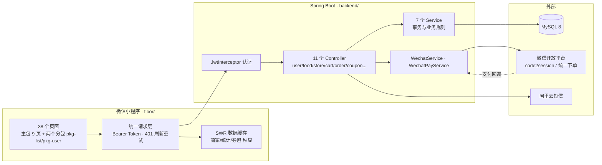

<div align="center">

# 🍜 food_wx

**基于 Spring Boot + 微信原生小程序的美食外卖点单系统**

从点餐、下单、支付到评价的完整外卖闭环，开箱即用的毕业设计与二次开发底座。

[](https://github.com/kedamano/food_wx/actions/workflows/ci.yml)
[](LICENSE)
[](https://spring.io/projects/spring-boot)
[](https://openjdk.java.net/)
[](https://developers.weixin.qq.com/miniprogram/dev/framework/)
[](#-测试与-ci)

</div>

---

## ✨ 项目亮点

- **完整外卖闭环** — 浏览 / 加购 / 下单 / 优惠券抵扣 / 微信支付 / 确认收货 / 评价，一条链路真实可用，无假数据冒充
- **真实微信能力** — `code2session` 微信登录、微信支付 V2 JSAPI 下单 + 回调验签，未配置商户号时自动降级为模拟支付
- **安全内建** — JWT + BCrypt + 角色鉴权（`@RequireRole`）+ 数据归属校验（防越权 IDOR）+ 支付回调验签，杜绝常见 Web 漏洞
- **测试门禁** — 后端 74 例（JUnit 5 + Mockito + H2 集成测试）+ 前端 71 例（Vitest，含请求行为锁定与 SWR 缓存），GitHub Actions 自动执行
- **清爽架构** — Controller / Service / Mapper 分层，全局异常处理，动态 SQL 更新，批量查询消除 N+1
- **SDD/TDD 驱动** — 剩余迭代先立规格（docs/specs/）再测试先行，authRequest 行为被测试锁定，重构有安全网

## 📊 系统架构



## 🧩 功能矩阵

| 模块 | 功能 | 状态 |
|------|------|:----:|
| 👤 用户 | 账密注册/登录、短信验证码、微信登录、找回密码、邀请码奖励（邀请人 +100 积分） | ✅ |
| 🏠 首页 | 轮播图、推荐美食、附近商家、搜索（美食 + 商家）、限时抢购 | ✅ |
| 🛒 购物车 | 加购/增减/删除/清空，本地与云端双模式，登录自动合并，批量查询 | ✅ |
| 📦 订单 | 下单、优惠券抵扣、取消（自动回补券）、退款（回补券+流水标记）、模拟支付、确认收货发积分、催单、订单统计、服务端分页 | ✅ |
| 💳 支付 | 微信支付 JSAPI 下单 + 回调验签（需商户号），未配置时降级模拟支付 | ✅ |
| 🎫 优惠券 | 兑换、本人券包、下单核销、取消回补、门槛/有效期校验 | ✅ |
| ⭐ 评价 | 订单评价（发积分）、菜品评价列表与统计、点赞/回复互动 | ✅ |
| ❤️ 收藏 | 商家收藏 + 菜品收藏（服务器态，跨设备同步） | ✅ |
| 📍 地址 | 增删改查、默认地址、31 省市区三级联动选择器 | ✅ |
| 🎁 积分 | 每日签到、真实任务系统（成单/评价实时判定）、积分商城兑换（库存/积分事务校验，券类自动发放） | ✅ |
| 💬 话题 | 话题列表、详情（参与商家聚合）、参与 | ✅ |
| 📱 设备管理 | 登录设备上报/列表/解绑 | ✅ |
| 🔐 安全 | 角色鉴权（ADMIN/MERCHANT/USER）、越权防护、支付回调验签 | ✅ |
| 🛵 骑手端 | 待配送订单池、接单派单、实时位置上报、确认送达（RIDER 角色 API） | ✅ API 就绪 |
| 📷 文件上传 | 头像、评价图片、反馈附图真实上传（白名单校验 + UUID 重命名） | ✅ |
| ⚡ 缓存 | 双层：服务端热点缓存（内存/Redis 双模式）+ 客户端 SWR（商家 10min/统计 60s 秒显，登录切换防串号） | ✅ |
| 🔑 会话 | Token 刷新换发（签名合法的过期 Token 换新），前端 401 自动刷新重试 | ✅ |
| 👨‍💼 商家管理后台 | 可视化运营界面（接口已就绪） | 🗺️ Roadmap |
| 🔔 消息通知 | 催单/派单通知推送 | 🗺️ Roadmap |

> ⚙️ 角色通过 `users.role` 字段手工授权（`ADMIN` / `MERCHANT`），没有内置管理后台。

## 🛠️ 技术栈

| 层 | 技术 |
|----|------|
| 后端框架 | Spring Boot 2.7.14 · Spring MVC |
| ORM | MyBatis + MyBatis-Plus（动态 SQL） |
| 数据库 | MySQL 8.0 |
| 认证 | JWT (jjwt) + BCrypt 密码散列 |
| 接口文档 | Swagger / springfox（`/api/swagger-ui/`） |
| 短信 | 阿里云短信 SDK |
| 前端 | 微信原生小程序（WXML/WXSS/JS），38 个页面（主包 9 + 分包 29） |
| 测试 | JUnit 5 · Mockito · H2(MODE=MySQL) · Vitest |
| CI/CD | GitHub Actions |

## 📁 项目结构

```
food_wx/
├── backend/                        # Spring Boot 后端
│   └── src/main/java/com/food/
│       ├── controller/             # 12 个 REST Controller
│       ├── service/                # 业务逻辑层（事务）
│       ├── mapper/                 # MyBatis 数据访问
│       ├── entity/                 # 数据库实体
│       ├── annotation/             # @RequireRole 角色注解
│       ├── aspect/                 # 角色校验切面
│       ├── interceptor/            # JWT 认证拦截器
│       ├── handler/                # 全局异常处理
│       └── utils/                  # JwtUtil · WechatService · WechatPayService ...
│   └── sql/
│       ├── schema.sql              # 建表脚本（MySQL 8 兼容）
│       └── data.sql                # 演示数据
├── floor/                          # 微信小程序前端（主包 < 2MB）
│   ├── pages/                      # 主包 9 页（tab/登录/首页/详情）
│   ├── pkg-list/                   # 分包：订单相关 8 页
│   ├── pkg-user/                   # 分包：个人中心与工具 21 页
│   ├── components/                 # error-retry 等共享组件
│   ├── utils/                      # format/order-format/cache(SWR) 等（含单测）
│   ├── api/                        # 请求封装（环境自适应 / 401 刷新重试）
│   ├── app.js                      # 全局购物车 / 登录态 / 请求中枢
│   └── __tests__/                  # Vitest 71 用例（含 authRequest 行为锁定）
├── docs/                           # 文档 + specs/（SDD 规格与验收标准）
└── .github/workflows/ci.yml        # CI：push/PR 自动跑前后端测试
```

## 🚀 快速开始

### 环境要求

| 依赖 | 版本 |
|------|------|
| JDK | 8+ |
| Maven | 3.6+ |
| MySQL | 8.0 |
| 微信开发者工具 | 最新版 |

### 1. 初始化数据库

```bash
mysql -u root -p < backend/sql/schema.sql       # 建库建表
mysql -u root -p < backend/sql/data.sql         # 基础演示数据
mysql -u root -p < backend/sql/demo_data.sql    # 全量演示数据（商家/商品/订单/评价/收藏 各约 500 条）
```

> 演示账号：`zhangsan` / `123456`（已加权：150 订单、75 收藏、60 优惠券、1250 积分）。未配置阿里云短信时验证码自动进入开发模式（打印在后端控制台）。

### 2. 配置并启动后端

修改 `backend/src/main/resources/application.yml` 中的数据库账号密码，或直接用环境变量覆盖：

```bash
cd backend
mvn spring-boot:run
```

服务启动在 `http://localhost:8080/api`，接口文档见 `http://localhost:8080/api/swagger-ui/`。

### 3. 启动小程序

1. 微信开发者工具导入 `floor/` 目录（填入自己的 AppID 或使用测试号）
2. 确认 `floor/api/config.js` 中的 `baseURL` 指向后端地址
3. 编译运行

> 💡 本地调试需在微信开发者工具中勾选「不校验合法域名」。

**真机调试**：手机与电脑同一 Wi-Fi，`floor/api/config.js` 的 `LAN_BASEURL` 改为电脑局域网 IP（`ipconfig` 查看），并以管理员放行 8080 入站：
```powershell
netsh advfirewall firewall add rule name="food_wx-8080" dir=in action=allow protocol=TCP localport=8080
```

### 4. 跑通测试

```bash
cd backend && mvn test      # 74 个用例（H2 内存库，无需 MySQL）
cd floor && npm install && npm test   # 71 个用例（请求行为锁定/SWR 缓存/纯函数）
```

## 🔐 环境变量

| 变量 | 必需 | 说明 |
|------|:----:|------|
| `JWT_SECRET` | 生产必需 | JWT 签名密钥，未设置时使用开发默认值（有启动告警） |
| `WX_APPID` | 微信登录/支付 | 小程序 AppID，配置后 `/user/wechat-login` 生效 |
| `WX_SECRET` | 微信登录/支付 | 小程序 AppSecret |
| `WX_PAY_MCH_ID` | 真实支付 | 微信支付商户号 |
| `WX_PAY_MCH_KEY` | 真实支付 | 商户 API 密钥（V2） |
| `WX_PAY_NOTIFY_URL` | 真实支付 | 支付回调地址，如 `https://your-domain/api/order/pay-notify` |

> 支付开关 `wx.pay.enabled` 默认 `false`：此时下单后走「模拟支付」直接完成支付；设为 `true` 且配齐商户参数后，前端自动切换为 `wx.requestPayment` 真实支付。

## 📡 API 概览

所有接口返回 `{ code, message, data }`；除公开只读接口外需携带 `Authorization: Bearer <token>`。

<details open>
<summary><b>用户 & 认证</b></summary>

| 方法 | 路径 | 说明 |
|------|------|------|
| POST | `/user/register` | 注册（短信验证码校验，支持邀请码） |
| POST | `/user/login` | 登录（用户名/手机号 + 密码） |
| POST | `/user/wechat-login` | 微信登录（code 换 openid） |
| POST | `/user/wechat-register` | 微信注册（已绑定则直接返回登录态） |
| POST | `/user/send-verify-code` | 发送短信验证码 |
| PUT | `/user/{userId}/password` | 修改密码 |
| GET | `/user/points/{userId}` | 积分信息（仅本人） |
| POST | `/user/sign-in/{userId}` | 每日签到 |
</details>

<details>
<summary><b>美食 & 商家</b></summary>

| 方法 | 路径 | 说明 |
|------|------|------|
| GET | `/food/{foodId}` · `/food/search` · `/food/category/{id}` | 菜品详情/搜索/分类 |
| GET | `/food/recommend` · `/food/banners` · `/food/categories` | 推荐/轮播图/分类列表 |
| POST/PUT/DELETE | `/food/**` | 菜品管理（`@RequireRole(MERCHANT)`） |
| GET | `/store/all` · `/store/{id}` · `/store/search` · `/store/nearby` | 商家信息 |
</details>

<details>
<summary><b>购物车 & 订单</b></summary>

| 方法 | 路径 | 说明 |
|------|------|------|
| POST | `/cart` · PUT `/cart/{cartId}` · DELETE `/cart/{cartId}` | 购物车增删改 |
| POST | `/cart/user/{userId}/merge` | 登录后合并本地购物车 |
| POST | `/order` | 下单（支持 `couponId` 抵扣、购物车项结算） |
| POST | `/order/{orderId}/pay-params` | 获取支付参数（wechat / mock 双模式） |
| POST | `/order/pay-notify` | 微信支付回调（验签，幂等） |
| PUT | `/order/{orderId}/cancel` · `/complete` · `/remind` | 取消（回补券）/确认收货/催单 |
| PUT | `/order/{orderId}/refund` | 退款（本人/商家，回补券 + 流水标记） |
| GET | `/order/user/{userId}?page=&size=&status=` | 订单列表（服务端分页，可选过滤） |
| GET | `/order/statistics` | 订单统计 |
| PUT | `/order/{orderId}/status` · GET `/order/store/{storeId}` | 状态流转/商家订单（商家/管理员） |
</details>

<details>
<summary><b>优惠券 & 评价 & 其他</b></summary>

| 方法 | 路径 | 说明 |
|------|------|------|
| GET | `/coupon/user/{userId}` | 本人券包（仅本人） |
| POST | `/coupon/exchange` | 兑换优惠券 |
| POST | `/review/order/{orderId}` | 订单评价（+30 积分） |
| GET | `/review/food/{foodId}` · `/food/{foodId}/statistics` | 菜品评价/统计 |
| GET/POST/PUT/DELETE | `/address/**` | 收货地址 CRUD + 设默认 |
| GET/POST/DELETE | `/favorite/**` | 收藏商家 |
| POST | `/feedback` | 意见反馈 |
| GET | `/rider/orders/pending` | 待配送订单池（RIDER/MERCHANT/ADMIN） |
| POST | `/rider/orders/{id}/dispatch` | 接单派单（订单进入配送中） |
| PUT | `/rider/orders/{id}/location` · `/deliver` | 骑手位置上报 / 确认送达 |
| POST | `/file/upload` | 图片上传（multipart，字段名 file） |
| POST | `/review/{id}/like` · `/reply` | 评价点赞切换 / 回复 |
| POST | `/food/{id}/favorite` | 菜品收藏切换 |
| GET | `/points-shop/products` · `/tasks` · POST `/exchange` | 积分商城 / 每日任务 / 兑换（事务） |
| GET | `/topic/list` · `/{id}` · POST `/{id}/join` | 话题列表 / 详情 / 参与 |
| POST | `/user/refresh-token` | Token 刷新换发（签名合法的过期 Token） |
| GET | `/region/tree` | 省市区三级数据（31 省） |
| GET/POST/DELETE | `/user/devices/**` | 登录设备上报 / 列表 / 解绑 |
</details>

## 🗄️ 数据库设计

15 张核心表：

`users`（含 role 角色） · `stores`（含经纬度） · `foods` · `categories` · `banners` · `cart` · `orders`（含 coupon_id） · `order_details` · `coupons` · `user_coupons`（核销状态） · `reviews` · `payment_records` · `points_log` · `user_favorites` · `feedback`

完整字段见 [`backend/sql/schema.sql`](backend/sql/schema.sql)。

## 🔒 安全设计

- **密码**：BCrypt 加盐散列，接口不回传密码字段
- **认证**：JWT 签名 + 过期校验，拦截器统一鉴权，401 触发前端自动重登
- **权限**：`@RequireRole` 注解 + AOP 切面实现 RBAC，`ADMIN` 通透
- **防越权**：订单/购物车/优惠券/积分/评价等资源全部校验「归属人」；管理类接口校验角色
- **支付安全**：回调 MD5 验签 + 订单状态幂等，伪造回调无效；XML 解析禁用 DOCTYPE 防 XXE
- **验证码**：限频 + 防重放，验证成功即销毁
- **信息卫生**：全局异常处理器兜底，不向前端泄露堆栈与内部消息；日志无 token 明文

## ✅ 测试与 CI

| 套件 | 用例数 | 覆盖 |
|------|:----:|------|
| 后端 `mvn test` | 74 | Service 单测（Mockito）+ 集成测试（H2 内存库）+ JWT/验证码工具 |
| 前端 `npm test` | 71 | 请求封装与 authRequest 行为锁定（401 刷新重试）+ SWR 缓存层 + 日期/订单/分类纯函数 |

GitHub Actions 在每次 push / PR 时自动运行两个测试作业（[ci.yml](.github/workflows/ci.yml)）。

## 🗺️ Roadmap

- [x] 退款流程（本人/商家可发起，同步支付流水并回补优惠券）
- [x] 骑手端 API：待配送订单池、接单派单、实时位置上报、确认送达（`RIDER` 角色）
- [x] 服务端分页（订单列表 + 菜品列表，`page/size` 可选参数，向后兼容）
- [x] 文件上传（`POST /file/upload`：头像 / 评价图片 / 反馈附图）
- [x] 热点读缓存（服务端内存/Redis + 客户端 SWR 双层）
- [x] 积分商城 / 每日任务 / 评价点赞回复 / 菜品收藏 / 话题 / 设备管理 / Token 刷新
- [x] 省市区三级联动（31 省完整数据）
- [x] 主包分包（4.3MB → 1.63MB，pkg-list + pkg-user）
- [ ] 附近商家按真实距离排序（stores 表经纬度已就绪）
- [ ] 微信支付升级 V3 API
- [ ] 骑手端小程序界面（当前为 API + 角色授权，无独立客户端）
- [ ] 商家管理后台（角色数据模型已就绪）
- [ ] 验证码迁移 Redis（当前 JVM 内存存储，多实例部署需先完成此项）
- [ ] 两套请求层结构合并（行为已统一并由测试锁定）

## 🤝 贡献

欢迎 Issue 与 PR！

1. Fork 本仓库 → 创建特性分支 `git checkout -b feature/xxx`
2. 请确保 `mvn test` 与 `npm test` 全绿（CI 会强制检查）
3. 提交 Pull Request

## 📜 开源协议

[MIT](LICENSE) © 2026 shenqing

## 🙏 致谢

- [Spring Boot](https://spring.io/projects/spring-boot) · [MyBatis Plus](https://baomidou.com/) · [Vitest](https://vitest.dev/)
- [微信小程序开发文档](https://developers.weixin.qq.com/miniprogram/dev/framework/)
- [Font Awesome](https://fontawesome.com/) · [Shields.io](https://shields.io/)

---

<div align="center">

如果这个项目对你有帮助，欢迎点一个 ⭐ Star

</div>
