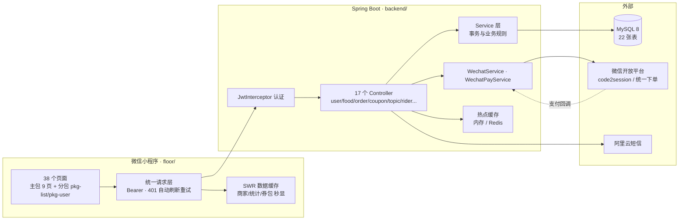
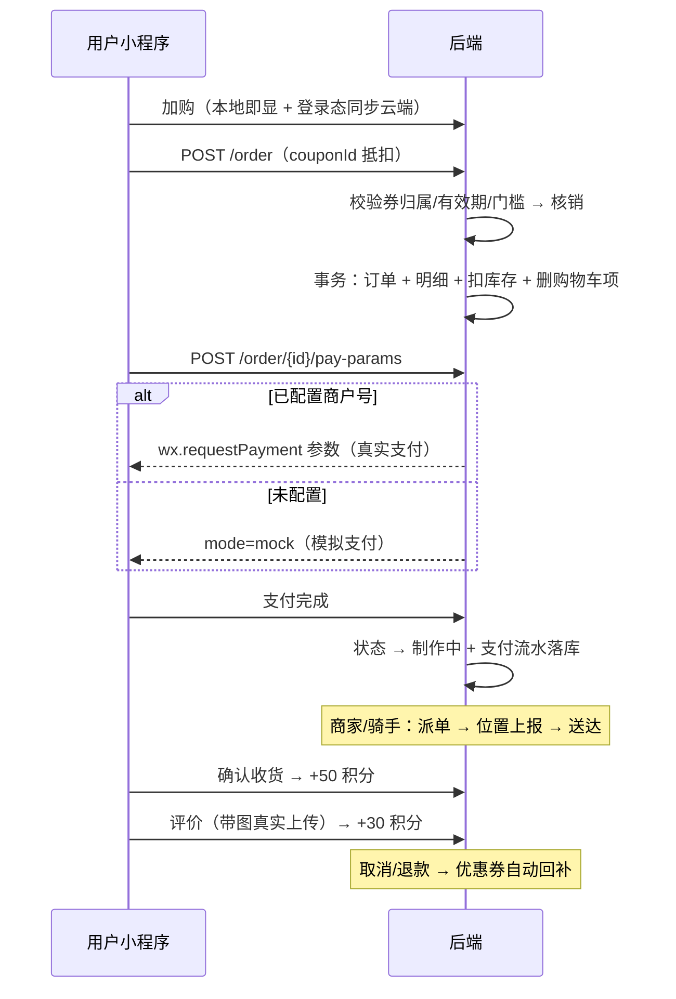
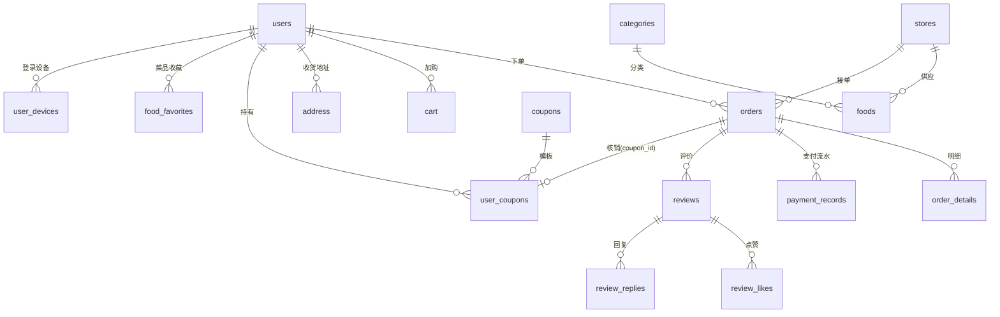

<div align="center">

# 🍜 food_wx

**基于 Spring Boot + 微信原生小程序的美食外卖点单系统**

从点餐、下单、支付到评价的完整外卖闭环 —— 开箱即用的毕业设计与二次开发底座

[](https://github.com/kedamano/food_wx/actions/workflows/ci.yml)
[](LICENSE)
[](https://spring.io/projects/spring-boot)
[](https://openjdk.java.net/)
[](https://developers.weixin.qq.com/miniprogram/dev/framework/)
[](#-测试与-ci)

</div>

---

## 📖 目录

- [项目亮点](#-项目亮点)
- [系统架构](#-系统架构)
- [核心业务流程](#-核心业务流程)
- [功能矩阵](#-功能矩阵)
- [技术栈](#-技术栈)
- [项目结构](#-项目结构)
- [快速开始](#-快速开始)
- [环境变量](#-环境变量)
- [API 概览](#-api-概览)
- [数据库设计](#-数据库设计)
- [安全设计](#-安全设计)
- [测试与 CI](#-测试与-ci)
- [FAQ · 踩坑实录](#-faq--踩坑实录)
- [更新日志](#-更新日志)
- [Roadmap](#%EF%B8%8F-roadmap)
- [贡献指南](#-贡献)

## ✨ 项目亮点

- **完整外卖闭环** — 浏览 / 加购 / 下单 / 优惠券抵扣 / 支付 / 确认收货 / 评价，一条链路真实可用，无假数据冒充
- **真实微信能力** — `code2session` 微信登录、微信支付 V2 JSAPI 下单 + 回调验签，未配置商户号时自动降级为模拟支付
- **安全内建** — JWT + BCrypt + 角色鉴权（`@RequireRole`）+ 数据归属校验（防越权 IDOR）+ 支付回调验签
- **双层缓存** — 服务端热点缓存（内存/Redis 双模式）+ 客户端 SWR（缓存秒显、后台刷新、断网兜底）
- **测试门禁** — 后端 74 例 + 前端 71 例（含请求层行为锁定），GitHub Actions 自动执行
- **SDD/TDD 驱动** — 迭代先立规格（`docs/specs/`）再测试先行，重构有安全网
- **工程化完备** — 17 个 Controller 分层清晰、全局异常处理、事务回滚修正、批量查询消 N+1、主包 1.63MB 分包架构

## 📊 系统架构



## 🔄 核心业务流程

下单主链路（优惠券核销、退款回补、积分奖励全部事务化）：



## 🧩 功能矩阵

| 模块 | 功能 | 状态 |
|------|------|:----:|
| 👤 用户 | 账密注册/登录、短信验证码、微信登录、找回密码、邀请码奖励（邀请人 +100 积分） | ✅ |
| 🏠 首页 | 轮播图、推荐美食、附近商家、搜索（美食 + 商家）、限时抢购 | ✅ |
| 🛒 购物车 | 加购/增减/删除/清空，本地即显 + 云端同步，登录自动合并 | ✅ |
| 📦 订单 | 下单、优惠券抵扣、取消（自动回补券）、退款（回补券+流水标记）、支付、确认收货发积分、催单、服务端分页 | ✅ |
| 💳 支付 | 微信支付 JSAPI 下单 + 回调验签（需商户号），未配置时降级模拟支付 | ✅ |
| 🎫 优惠券 | 兑换、本人券包、下单核销、取消/退款回补、门槛/有效期校验 | ✅ |
| ⭐ 评价 | 订单评价（发积分）、菜品评价列表与统计、点赞/回复互动 | ✅ |
| ❤️ 收藏 | 商家收藏 + 菜品收藏（服务器态，跨设备同步） | ✅ |
| 📍 地址 | 增删改查、默认地址、31 省市区三级联动选择器 | ✅ |
| 🎁 积分 | 每日签到、真实任务系统（成单/评价实时判定）、积分商城兑换（事务校验，券类自动发放） | ✅ |
| 💬 话题 | 话题列表、详情（参与商家聚合）、参与 | ✅ |
| 📱 设备管理 | 登录设备上报/列表/解绑 | ✅ |
| 🛵 骑手端 | 待配送订单池、接单派单、实时位置上报、确认送达（`RIDER` 角色 API） | ✅ API |
| 📷 文件上传 | 头像、评价图片、反馈附图（白名单校验 + UUID 重命名） | ✅ |
| ⚡ 缓存 | 双层：服务端热点（内存/Redis）+ 客户端 SWR（秒显/防串号/断网兜底） | ✅ |
| 🔑 会话 | Token 刷新换发，前端 401 自动刷新并重试原请求 | ✅ |
| 👨‍💼 商家管理后台 | 可视化运营界面（角色数据模型已就绪） | 🗺️ Roadmap |
| 🔔 消息通知 | 催单/派单推送 | 🗺️ Roadmap |

> ⚙️ 角色通过 `users.role` 手工授权（`ADMIN` / `MERCHANT` / `RIDER`），无内置管理后台。

## 🛠️ 技术栈

| 层 | 技术 |
|----|------|
| 后端框架 | Spring Boot 2.7.14 · Spring MVC |
| ORM | MyBatis + MyBatis-Plus（动态 SQL） |
| 数据库 | MySQL 8.0（22 张表） |
| 认证 | JWT (jjwt) + BCrypt + Token 刷新换发 |
| 接口文档 | Swagger（`/api/swagger-ui/`） |
| 短信 | 阿里云短信 SDK（未配置自动进开发模式） |
| 前端 | 微信原生小程序，38 页（主包 9 + 分包 29），主包 1.63MB |
| 缓存 | 服务端 Spring Cache（内存/Redis）+ 客户端 SWR 缓存层 |
| 测试 | JUnit 5 · Mockito · H2(MODE=MySQL) · Vitest |
| CI/CD | GitHub Actions |

## 📁 项目结构

```
food_wx/
├── backend/                        # Spring Boot 后端
│   └── src/main/java/com/food/
│       ├── controller/             # 17 个 REST Controller
│       ├── service/                # 业务逻辑层（事务 + 回滚修正）
│       ├── mapper/                 # MyBatis 数据访问（含批量查询）
│       ├── entity/                 # 数据库实体
│       ├── annotation/aspect/      # @RequireRole + RBAC 切面
│       ├── interceptor/            # JWT 认证拦截器
│       ├── handler/                # 全局异常处理
│       └── utils/                  # JwtUtil · WechatService · WechatPayService · CacheConfig
│   └── sql/
│       ├── schema.sql              # 22 张表（MySQL 8 兼容）
│       ├── data.sql + demo_data.sql  # 演示数据（各实体约 500 条，生成器可复跑）
│       └── gen_demo.py             # 演示数据生成器（含真实图片抓取）
├── floor/                          # 微信小程序前端（主包 < 2MB）
│   ├── pages/                      # 主包 9 页（tab/登录/首页/详情）
│   ├── pkg-list/                   # 分包：订单相关 8 页
│   ├── pkg-user/                   # 分包：个人中心与工具 21 页
│   ├── components/                 # error-retry 等共享组件
│   ├── utils/                      # format / order-format / cache(SWR) / category-tabs（含单测）
│   ├── api/                        # 请求封装（环境自适应 / 401 刷新重试）
│   └── __tests__/                  # Vitest 71 用例
├── docs/
│   ├── specs/                      # SDD 规格与验收标准
│   └── *.md                        # 代码审查 / TDD 实施报告
└── .github/workflows/ci.yml        # CI：push/PR 自动跑前后端测试
```

## 🚀 快速开始

### 环境要求

| 依赖 | 版本 |
|------|------|
| JDK | 8+ |
| Maven | 3.6+ |
| MySQL | 8.0 |
| Node.js | 18+（前端测试） |
| 微信开发者工具 | 最新版 |

### 1. 初始化数据库（3 条命令）

```bash
mysql -u root -p < backend/sql/schema.sql       # 建库建表（22 张）
mysql -u root -p < backend/sql/data.sql         # 基础数据
mysql -u root -p < backend/sql/demo_data.sql    # 全量演示数据（商家/商品/订单/评价/收藏 各约 500 条）
```

> 演示账号：**`zhangsan` / `123456`**（已加权：150 订单、75 收藏、60 优惠券、1250 积分）。未配置阿里云短信时验证码自动进入开发模式（打印在后端控制台）。

### 2. 启动后端

```bash
cd backend
mvn spring-boot:run        # http://localhost:8080/api（Swagger: /api/swagger-ui/）
```

数据库账号密码在 `application.yml` 或用环境变量覆盖。

### 3. 启动小程序

1. 微信开发者工具导入 `floor/` 目录（自己的 AppID 或测试号）
2. `floor/api/config.js` 环境自适应：**开发者工具自动走 localhost，真机自动走局域网 IP**（`LAN_BASEURL` 常量按 `ipconfig` 修改）
3. 编译运行，勾选「不校验合法域名」

> **真机调试**还需：手机与电脑同一 Wi-Fi + 管理员放行防火墙：
> ```powershell
> netsh advfirewall firewall add rule name="food_wx-8080" dir=in action=allow protocol=TCP localport=8080
> ```

### 4. 跑通测试

```bash
cd backend && mvn test                 # 74 例（H2 内存库，无需 MySQL）
cd floor && npm install && npm test    # 71 例（请求行为锁定 / SWR / 纯函数）
```

## 🔐 环境变量

| 变量 | 必需 | 说明 |
|------|:----:|------|
| `JWT_SECRET` | 生产必需 | JWT 签名密钥（未设置用开发默认值，有启动告警） |
| `WX_APPID` / `WX_SECRET` | 微信登录 | 配置后 `/user/wechat-login` 生效 |
| `WX_PAY_MCH_ID` / `WX_PAY_MCH_KEY` | 真实支付 | 商户号 / V2 API 密钥 |
| `WX_PAY_NOTIFY_URL` | 真实支付 | 回调地址，如 `https://your-domain/api/order/pay-notify` |
| `FILE_UPLOAD_DIR` | 生产建议 | 上传文件目录（默认项目内，务必指向持久磁盘） |
| `CACHE_TYPE` | 可选 | `memory`（默认）/ `redis` |

> 支付开关 `wx.pay.enabled` 默认 `false`：下单后走「模拟支付」直接完成；设为 `true` 且配齐商户参数后自动切换 `wx.requestPayment` 真实支付。

## 📡 API 概览

统一返回 `{ code, message, data }`；除公开只读接口外需带 `Authorization: Bearer <token>`。

<details open>
<summary><b>用户 · 认证 · 会话</b></summary>

| 方法 | 路径 | 说明 |
|------|------|------|
| POST | `/user/register` | 注册（短信验证码 + 邀请码奖励） |
| POST | `/user/login` · `/wechat-login` · `/wechat-register` | 账密 / 微信登录 / 微信注册 |
| POST | `/user/send-verify-code` | 短信验证码（未配置自动进开发模式） |
| POST | `/user/refresh-token` | Token 刷新换发（签名合法的过期 Token） |
| POST | `/user/sign-in/{userId}` | 每日签到 |
| GET/POST/DELETE | `/user/devices/**` | 登录设备上报 / 列表 / 解绑 |
| GET | `/region/tree` | 省市区三级数据（31 省） |
</details>

<details>
<summary><b>美食 · 商家 · 收藏</b></summary>

| 方法 | 路径 | 说明 |
|------|------|------|
| GET | `/food/{id}` · `/food/search` · `/food/category/{id}` | 详情 / 搜索 / 分类 |
| GET | `/food/recommend` · `/food/banners` · `/food/categories` | 推荐 / 轮播 / 分类（服务端缓存） |
| POST | `/food/{id}/favorite` · GET `…/status` | 菜品收藏切换 / 状态 |
| POST/PUT/DELETE | `/food/**` | 菜品管理（`@RequireRole(MERCHANT)`） |
| GET | `/store/all` · `/{id}` · `/search` · `/nearby` | 商家信息 |
| GET/POST/DELETE | `/favorite/**` | 商家收藏 |
</details>

<details>
<summary><b>购物车 · 订单 · 支付</b></summary>

| 方法 | 路径 | 说明 |
|------|------|------|
| POST/PUT/DELETE | `/cart/**` | 购物车增删改 |
| POST | `/cart/user/{userId}/merge` | 登录后合并本地购物车 |
| POST | `/order` | 下单（couponId 抵扣，事务核销） |
| POST | `/order/{id}/pay-params` | 支付参数（wechat / mock 双模式） |
| POST | `/order/pay-notify` | 微信支付回调（验签 + 幂等） |
| PUT | `/order/{id}/cancel` · `/refund` · `/complete` · `/remind` | 取消（回补券）/ 退款 / 确认收货 / 催单 |
| GET | `/order/user/{userId}?page=&size=&status=` | 订单列表（服务端分页） |
| GET | `/order/statistics` | 订单统计 |
| GET | `/rider/**` | 骑手端：待配送池 / 派单 / 位置上报 / 送达 |
</details>

<details>
<summary><b>优惠券 · 评价 · 积分 · 其他</b></summary>

| 方法 | 路径 | 说明 |
|------|------|------|
| GET | `/coupon/user/{userId}` · POST `/coupon/exchange` | 券包（仅本人）/ 兑换 |
| POST | `/review/order/{orderId}` | 订单评价（+30 积分） |
| POST | `/review/{id}/like` · `/reply` | 点赞切换 / 回复 |
| GET | `/points-shop/products` · `/tasks` · POST `/exchange` | 积分商城 / 每日任务 / 兑换（事务） |
| GET/POST | `/topic/**` | 话题列表 / 详情 / 参与 |
| GET/POST/PUT/DELETE | `/address/**` | 地址 CRUD + 设默认 |
| POST | `/file/upload` | 图片上传（multipart，字段 file） |
| POST | `/feedback` | 意见反馈 |
</details>

## 🗄️ 数据库设计

22 张表，核心域模型：



其余：`banners` · `points_log` · `user_favorites` · `points_products` · `topics` · `feedback`。完整字段见 [`schema.sql`](backend/sql/schema.sql)。

## 🔒 安全设计

- **密码**：BCrypt 加盐散列，接口不回传
- **认证**：JWT 签名 + 过期校验 + 刷新换发；401 触发前端自动刷新重试
- **权限**：`@RequireRole` + AOP 实现 RBAC（ADMIN/MERCHANT/RIDER）
- **防越权**：订单/购物车/优惠券/积分/评价/设备全部校验归属人
- **支付安全**：回调 MD5 验签 + 状态幂等；XML 解析禁 DOCTYPE 防 XXE
- **验证码**：限频 + 防重放，验证即销毁
- **信息卫生**：全局异常兜底不泄露堆栈；日志无 token/验证码明文

## ✅ 测试与 CI

| 套件 | 用例数 | 覆盖 |
|------|:----:|------|
| 后端 `mvn test` | 74 | Service 单测（Mockito）+ H2 集成测试 + JWT/验证码/邀请码 |
| 前端 `npm test` | 71 | authRequest 行为锁定（401 刷新重试）+ SWR 缓存 + 日期/订单/分类纯函数 |

GitHub Actions 每次 push/PR 自动双作业执行（[ci.yml](.github/workflows/ci.yml)）。

## ❓ FAQ · 踩坑实录

> 以下全部是本项目开发中真实踩过并解决的坑，供同路人参考。

**Q1：真机请求全部 `ERR_CONNECTION_REFUSED`？**
手机上的 `localhost` 是手机自己。`config.js` 已按运行载体自适应（devtools→localhost，真机→`LAN_BASEURL`），还需同 Wi-Fi + 防火墙放行 8080（见快速开始）。

**Q2：图标在真机显示成色块/不显示？**
微信安卓内核对 CSS mask 和 SVG data-URI 背景图支持不全。本项目最终方案：**Edge 无头渲染 SVG → PNG base64** 写入 background-image + `background-size: contain`，全内核兼容。

**Q3：`MultipartFile.transferTo` 报 FileNotFoundException？**
传相对 `File` 时 Spring 按 tomcat 临时目录解析。必须 `getAbsoluteFile()` 后再写。

**Q4：Spring Boot 的 `spring.jackson.*` 配置不生效？**
检查是否有人继承 `WebMvcConfigurationSupport`——它会静默禁用全部 MVC 自动配置。改用实现 `WebMvcConfigurer`。

**Q5：分包后页面跳转全部失败？**
页面移入 subPackages 后路径从 `/pages/x/x` 变为 `/pkg-*/x/x`，全项目跳转字符串要同步迁移。

**Q6：SWR 缓存接入后数字时对时错？**
不要用"回调计数凑满 N"的聚合模式——SWR 每个源触发 0~2 次回调。正确姿势：**每个数据源独立 setData 自己的字段路径**。

## 📋 更新日志

<details>
<summary><b>展开完整演进（2026-04 → 2026-10）</b></summary>

- **2026-10-24（晚）**：客户端 SWR 缓存层（TDD）；修复 profile 统计聚合竞态；头像上传链路修复（transferTo 绝对路径 + 响应解包）
- **2026-10-24**：A 类产品能力全量实现——积分商城（事务兑换）/ 评价点赞回复 / 菜品收藏 / 设备管理 / 话题 / 商家内分类 / Token 刷新；TheMealDB + Unsplash 真实图片替换
- **2026-10-24（早）**：SDD/TDD 迭代——4 个测试文件锁定行为并抓出 tryRefreshToken 未落地真 bug；error-retry 组件；分包（主包 4.3MB→1.63MB）；清查 20 个 0 字节损坏图
- **2026-10-24（凌晨）**：UI 设计系统（语义 token / 39 个 SVG 图标 / 全站色板迁移 / tabBar 重绘）；修复全局 container 细条、订单/地址页信息架构重构
- **2026-10-23**：全量演示数据生成器（各实体约 500 条）；真实微信登录/支付/优惠券核销/购物车后端化；Roadmap 五项（退款/骑手 API/服务端分页/文件上传/缓存）全部落地
- **2026-10-22**：P0 救火（改密失效/越权/DebugController 后门）+ TDD 测试基建入库 + CI 门禁 + springfox 兼容修复
- **2026-04**：初始版本（多页面功能 + 订单流程修复）

</details>

## 🗺️ Roadmap

- [x] 退款 / 骑手 API / 服务端分页 / 文件上传 / 双层缓存
- [x] 积分商城 / 每日任务 / 评价互动 / 菜品收藏 / 话题 / 设备管理 / Token 刷新
- [x] 省市区三级联动（31 省）· 主包分包
- [ ] 附近商家按真实距离排序（经纬度数据已就绪）
- [ ] 微信支付升级 V3 API
- [ ] 骑手端小程序界面（API 已就绪）
- [ ] 商家管理后台（角色模型已就绪）
- [ ] 验证码迁移 Redis（多实例部署前置项）
- [ ] 两套请求层结构合并（行为已统一并由测试锁定）

## 🤝 贡献

欢迎 Issue 与 PR！

1. Fork → `git checkout -b feature/xxx`
2. 确保 `mvn test` 与 `npm test` 全绿（CI 强制检查）
3. 提交 Pull Request

## 📜 开源协议

[MIT](LICENSE) © 2026 shenqing

## 🙏 致谢

- [Spring Boot](https://spring.io/projects/spring-boot) · [MyBatis Plus](https://baomidou.com/) · [Vitest](https://vitest.dev/)
- [微信小程序开发文档](https://developers.weixin.qq.com/miniprogram/dev/framework/)
- [TheMealDB](https://www.themealdb.com/) · [Unsplash](https://unsplash.com/)（演示图片来源）

---

[](https://star-history.com/#kedamano/food_wx&Date)

<div align="center">

如果这个项目对你有帮助，欢迎点一个 ⭐ Star

</div>
